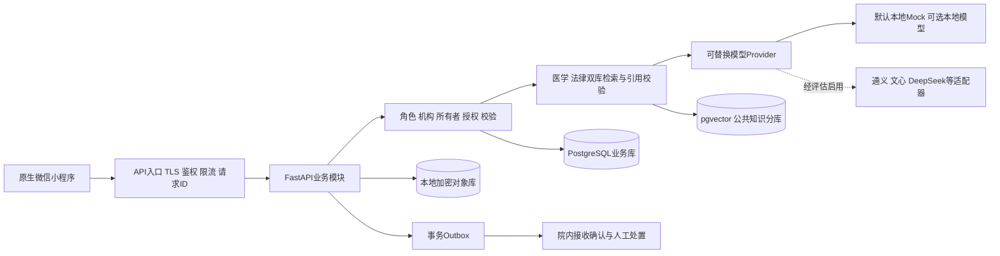

# 医法智联技术设计

本文件是后续开发规格。当前可运行范围以根目录及后端 README 为准。

## 分层



演示阶段 API 入口与业务、AI 服务同进程，不部署微服务。本机 SQLite 提供关系表、事务和重启持久化，后续有医院试点和多人并发需求时再迁移 PostgreSQL；本地词项检索替代向量检索。公开法条与医院审核资料可进入共享知识库；患者病历不得写入公共向量库。

## 后续目录

在已有代码上增加以下文件，均为待实现项：

```text
miniprogram/
  pages/records/index.{js,json,wxml,wxss}
  pages/consent-document/index.{js,json,wxml,wxss}
  pages/volunteer/index.{js,json,wxml,wxss}
  components/citation-card/index.{js,json,wxml,wxss}
  components/permission-sheet/index.{js,json,wxml,wxss}
  services/{auth,records,documents,volunteer}.js
  utils/{mask,clock}.js
backend/
  app/api/{wechat,records,documents,volunteer}.py
  app/services/{ocr,documents,notifications}.py
  app/ai/providers/{local,qwen,wenxin,deepseek}.py
  app/ai/{vector_retriever,reranker,citation_verifier}.py
  app/security/{crypto,redaction,policy}.py
  app/jobs/{ocr_worker,outbox_worker,retention}.py
  app/models/{users,records,consents,conversations,vitals}.py
  app/repositories/{postgres,objects}.py
  migrations/
  knowledge/{medical,legal}/
  tests/{test_record_acl,test_document_state,test_outbox}.py
```

## 状态机

- 个人信息授权：告知 → 用户单独授权 → 到期/撤回；每次访问重新核验；队列任务执行前再次核验。目的、类别、字段、接收方、期限、政策版本分别记录。
- 临床知情同意：`draft → clinician_reviewed → explained → signed → archived`。医生解释风险和替代方案、患者理解、授权代签、签名验证均是独立事实；任何修改生成新版本。
- 紧急事件：`received → dispatching → acknowledged / failed / cancelled`。接收方逐一记录投递与确认，多渠道通知不能等同手机自动同时拨号。
- OCR：上传校验 → 去EXIF/扫描 → OCR → 标记低置信度 → 用户/医护核对 → 版本化归档。OCR文本不是医院认证病历副本。
- 志愿者：身份/班次审核 → 可见导诊任务 → 接单 → 到场 → 完成；地图纠错需院方审核。仅见会合点与辅助需求。

## RAG 与预警

RAG 输入顺序：鉴权 → 授权 → 出站隐私检查 → 按领域/机构/版本/有效时间过滤 → 检索 → 证据充足性判断 → 生成 → 核验引用。检索文档是数据，不得覆盖系统规则；提供 URL、条号、版本、片段定位；无依据则明确拒答或转人工。

健康数据保留 `device_id, sample_id, source, kind, value, unit, measured_at, received_at, quality`；设备认证并绑定患者，客户端不能任意指定 patient_id。范围异常、时钟偏差、重复样本、失联分别处理。阈值需医护审核并按患者个体设定，持续时间、质量门槛、去重冷却和回执均不可省。演示规则不用于医学决策。

## 上线验收标准

越权请求拒绝；撤回后新请求及排队任务停止相应处理；知识域与机构隔离；所有法条引用可回查；OCR错误可追溯更正；文书不能跳过医生审核；重复呼叫不生成重复事件；无接收回执不得出现“已接通”；断网提示人工救助路径；日志不含患者正文和密钥。
