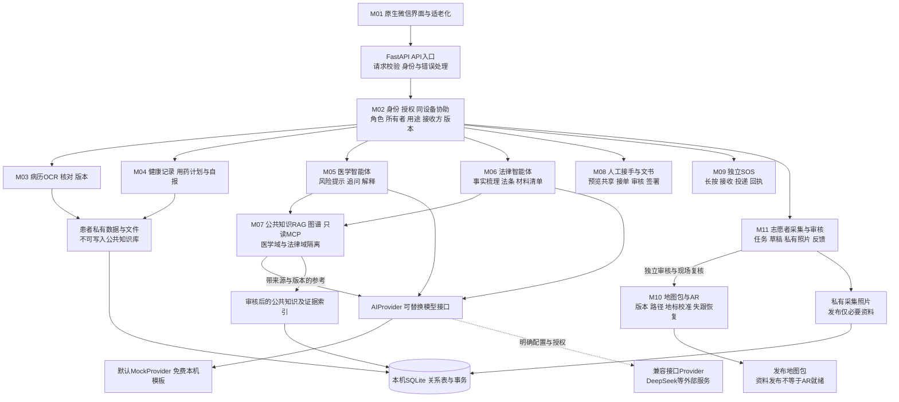
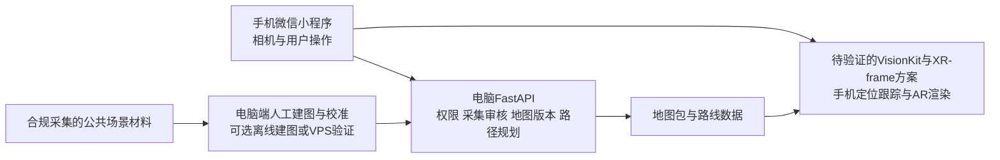
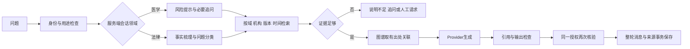
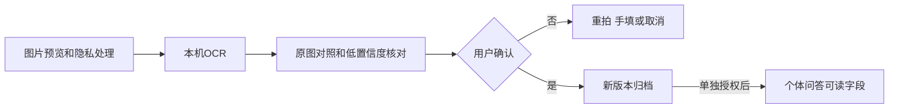

# 医法智联技术架构与模块接口

更新日期：2026-10-17。本文件是现有工程到目标产品的设计；M11 主流程已实施，实际接口与验收见[M11说明](m11-acceptance.md)，其他目标能力仍按各模块状态实施。模块编号与[产品计划](product-plan.md)一致，先后顺序见[实施路线图](implementation-roadmap.md)。当前API与启动方式以[后端说明](../backend/README.md)为准。

## 1 总体模块方框



SOS不依赖模型回复；患者数据与公共语料分开；审核员与采集者共用小程序但不共享权限。图中大部分模块是目标，当前仅有基础界面、授权、少量关键词检索、单轮模型适配、SQLite及演示SOS。

FastAPI采用模块化单体。Python用于复用OCR、检索和图谱工具；SQLite无需额外数据库服务，先满足本机演示。没有当前需求证明必须使用微服务、Redis、图数据库或独立ERP；多人真实试点需要时再评估PostgreSQL与对象存储，不把它们放进当前必装依赖。

### 客户端布局与运行位置

|页面或入口|承载模块|职责|
|---|---|---|
|健康Tab|M01、M04、M05|健康记录、每日用药待办、计划与知识问答入口|
|导诊Tab|M01、M10、M11|选择目的地、地图/AR、用户反馈与受控工作入口|
|法援Tab|M01、M06、M07、M08|法律咨询、证据图谱、文书和人工帮助|
|我的Tab|M01、M02、M03、M09|病历、设置授权、设备、联系人与SOS|
|独立聊天页|M05、M06、M07|领域标识、追问、参考资料与人工接手|
|同小程序角色入口|M02、M08、M11|志愿者任务、采集审核及医护/律师接单；按服务端权限开放|



手机负责相机帧、定位跟踪和实景显示；电脑负责资料与地图管理、规划及可选离线建图。VisionKit/XR-frame是否能满足本项目所需能力、机型与基础库条件，必须做能力验证；它们不自动提供完整医院地图或通用VPS。当前本机API地址仅适用于模拟器，真机需要受控测试HTTPS链路。

## 2 当前文件和目标文件

```text
miniprogram/
  app.{js,json,wxss}
  pages/{home,navigation,legal,profile,chat}/index.{js,json,wxml,wxss}
  components/{app-header,emergency-button}/index.{js,json,wxml,wxss}
  services/api.js
  config/index.js
  utils/errors.js
backend/app/
  main.py                       # 应用与当前用途政策
  config.py                     # 后端本机配置，不放前端
  db.py                         # SQLite与事务
  schema.sql                    # 当前实际表
  schemas.py
  api/{routes,dependencies}.py
  ai/providers/{base,mock,compatible,factory}.py
  ai/redaction.py               # 演示检查，不保证匿名化
  services/{rag,vitals}.py
  backup.py
backend/tests/                  # 临时数据库与假服务测试
```

以下为目标文件位置；M11 已落在 backend/app/api/navigation.py、miniprogram/services/navigation.js 和对应页面，其他位置仍按模块实施，不一次引入所有依赖：

```text
backend/app/
  workflows/{medical,legal,state}.py
  knowledge/{ingest,retriever,graph,citations}.py
  services/{ocr,record_versions,handoffs,documents,notifications}.py
  tools/{registry,mcp_client}.py
  security/{policy,crypto}.py
  navigation/{maps,routes,landmarks,review,feedback}.py
miniprogram/
  pages/navigation-workbench/index.{js,json,wxml,wxss}
  pages/route-capture/index.{js,json,wxml,wxss}
  pages/route-review/index.{js,json,wxml,wxss}
  pages/service-workbench/index.{js,json,wxml,wxss}
  services/{records,knowledge,navigation,handoffs}.js
  components/{citation-card,record-review,permission-sheet}/index.*
```

导诊Tab从已发布路线接口获取起终点、楼层、实拍节点数等摘要，支持搜索；选择路线并确认起点后进入照片导览，用户手动切换节点，不计算虚构距离或自动到达。顶部“采集 / 审核”进入导航工作台，集中任务、本人草稿、审核队列与用户反馈；采集页逐节点编辑与选图；审核页查看私有图片、退回、发布和停用。这三页及 photo-walkthrough 已注册为现有路由。服务工作台仍是规划，未来承载人工接单和处理状态。`docs/schema.sql`是早期生产模型草案；当前 M11 使用 backend/app/schema.sql 的版本5及增量建表。

## 3 授权和数据边界

当前`GET /consents`返回用途`policies`，授权提交准确`recipient`和`policy_version`。外部AI发送前读取授权快照，网络在数据库事务外调用，保存与返回前再次核验；撤回或重新授权使旧回复失效。服务端不能收回已发送请求。令牌随机生成、只存摘要，授权和令牌到期不因重启重置。

目标权限同时检查身份、角色、机构、所有者、用途、字段、接收方、告知版本和期限。导航角色由`navigation_memberships`分配，不接受客户端自称审核员；导航会话与患者AI令牌分离，身份切换中止旧请求并忽略晚到返回。家属协助只记录同设备操作与患者确认，不能产生已实名代理审计。

|数据|策略|
|---|---|
|姓名、电话、联系人|显示遮罩；真实通知按用途使用；日志无原值|
|微信标识、院内患者号、令牌|仅后端受控；令牌摘要；禁止模型出站|
|病历正文、影像、疾病、过敏、用药、体征|按患者隔离、真实资料加密；不进入公共索引和日志|
|会话及个人图谱|按患者、领域和用途读取；撤回覆盖后续工具和派生索引|
|导航图片、采集位置与时间|仅允许区域、去非必要EXIF；私有原图，公开内容另经审核|
|公共知识和地图包|记录来源、版本、审核与停用状态，不混入患者资料|

现有数据库未加密，身份是合成演示身份；简单遮罩及字符串扫描不能证明匿名化，生产权限和存储需另行验证。

## 4 双智能体核心流程



先实现固定状态工作流，复杂分支再评估LangGraph。公共医学/法律问答只必需M02和M07；M03病历、M04体征、M08人工接手工具各自完成验收后按需开放，不成为公共问答的先决条件。医学、法律工具白名单和知识域独立，跨域需患者确认最少摘要后新建会话。工具输出与检索文档均是不可信数据，不能覆盖权限规则；模型不能直接改病历、发布地图、签署或触发SOS。

当前`AIProvider.generate(domain,text,context)`已经隔离厂商调用，兼容接口适配器与本地Mock可切换；特殊协议新增适配器。`services/knowledge.py`从SQLite的`knowledge_sources/knowledge_chunks`读取已发布且在有效期内的片段，按域关键词检索；检索结果只在服务端用于生成，不再向聊天接口返回`source`字段，也未实现每项结论的自动证据核验。旧的内存`CORPORA`只保留给不传数据库的Provider测试，API请求走知识库。

M05 第一版固定工作流在 `services/medical_agent.py`：`plan` 分类为 crisis/urgent/medication/diagnosis/procedure/report/symptom/lifestyle/general 并识别医学主题；`boundary_answer` 对急症、个人诊断、处方调整做本地拦截，不调用模型；普通问题检索同域片段后由 Provider 生成，`enrich` 统一补充 `category/topic/topic_key/external_ai`。2026-10-24 起接口不再计算或返回 `suggestions`（追问建议字段已删除）；2026-10-23 起气泡内不再渲染“你还可以问”，提问入口只保留输入框上方的快捷问题，历史回看只还原公开字段。聊天页另按资料和已授权的健康概览生成最多 3 条个性化提问入口，只做提问导航，不诊断、不调药、不调用模型。该流程仍是单轮，未实现跨轮槽位、检查结果追问或用药清单联动。

M06 第一版固定工作流在 `services/legal_agent.py`：`plan` 分类为 crisis/consent/records/privacy/dispute/liability/compensation/overcheck/out_of_scope/general 并给出主题；`boundary_answer` 对人身安全、责任认定和赔偿金额做本地拦截；`guide_answer` 对知情同意、病历、隐私、纠纷和超范围问题使用本地审校文字，同域检索只在服务端作为生成参考；只有一般法律知识才检索后交给 Provider，`enrich` 统一补充 `category/topic/topic_key/materials/next_steps/external_ai`。法律域独立检索，不混用医学片段；聊天页展示主题、材料清单和下一步（气泡内不再渲染合并后的追问问句），不再单列问医务科/律师清单。该流程仍是单轮，未实现事实时间线、跨轮槽位、材料上传或律师工单。

知识状态：`draft → reviewed → published → retired`。来源保存标题、URL、文档版本、有效时间、审核人和片段位置；图谱每条边绑定证据。公共知识先用SQLite节点边表，个人图谱单独所有者过滤。MCP先只读，登记工具名、领域、用途、超时、返回量和字段范围；调用失败不伪造结果，不直接发患者全文给第三方服务。当前只有第一版读模型和内部检索，尚无知识录入/审核后台、向量检索与图谱。

## 5 病历和人工服务流程



M03已在Python 3.14服务外使用独立Python 3.12进程运行RapidOCR 1.4.4，模型随安装包预置，不调用云OCR。schema 6新增`record_documents/record_ocr_jobs/record_document_versions/record_document_events`，保存私有原图BLOB、当前草稿、识别原文及位置、确认快照和幂等操作。OCR失败重试仍保留先前字段的原始任务来源；确认事务失败不会留下虚假归档。下载、定位裁剪、OCR和版本均核对所有者及用途授权，长时识别完成前重新检查授权与会话。PaddleOCR对照基准未完成，当前合成样本实测及限制见[M03验收](m03-acceptance.md)。

M04当前使用`health_entries`保存手填测量与身体感受，来源仅为manual/report，血压同条记录保存收缩压与舒张压，测量时间与录入时间分开。趋势按实际测量时间绘制离散点，空白不插值。`health_medication_plans`保存当前每日计划，`health_plan_versions`保存生效区间，`health_dose_logs`保存时段对应的药品用量快照与本人报告的实际服药时间，`health_followups`保存个人待办。按北京时间划分日期，数据库时间统一UTC。创建请求幂等，修改使用revision；暂停或修改仅重算之后的未报告任务，过去安排与已报告事件保留。删除计划会连同服药记录删除，前端明确确认。`GET /health-management/summary?days=7|30`按同一授权汇总区间内的测量、感受、用药执行和未完成待办，只区分已服用/已跳过/稍后处理/未记录/待记录，不计算依从率或自动判断。

所有`/health-management/*`接口要求患者身份、本人资源归属和`vitals`用途下的`health-records-1`授权。旧演示授权不可直接沿用；旧设备读数不导入。旧药品数据仅首次升级迁为暂停计划，旧写入接口返回410以防双份数据。新模块不调用外部AI。数据保存于电脑端SQLite，非手机离线保存；当前部署保护未达到面向真实用户的生产条件。

日历提醒通过用户主动操作`wx.addPhoneCalendar`创建单次系统日程；失败不标作已提醒或已服药。小程序后台采集、医院/厂商同步、订阅消息投递与临床异常告警均未实现。未来设备层再引入device_id、sample_id、质量、鉴权和设备失联状态，阈值需要适用场景审核。

人工请求：`requested → accepted → in_progress → completed/failed/cancelled`。接收侧使用同小程序权限化接单页，不建ERP；服务端检查资格、角色、医院、工单归属与允许字段，接收者只能读取患者确认的共享摘要。首轮做草稿与工单闭环；正式签署在真实渠道、资质和验签齐备后另接。目标临床文书状态为`draft → clinician_reviewed → explained → signed → archived`，内容变更重新确认。SOS当前只有本机演示接收/取消；未来事件与各接收对象分别记录`received → dispatching → acknowledged/failed/cancelled`，没有真实回执不得显示已接通。

## 6 导航采集审核拟议契约

下表保留原始设计。已经落地的 M11 路径采用 /navigation/submissions 及 revision，完整实际清单见[M11接口](m11-acceptance.md#数据与接口)，不能把此处规划接口直接当作已实现接口。

下表全部为设计中接口，均带`/api/v1`前缀；不是当前OpenAPI。演示阶段仅合成材料，真实医院采集需另满足许可和隐私条件。

|方法和路径|输入与输出要点|
|---|---|
|GET `/navigation/me`|返回医院、角色及`permissions:{collect,review,browse,feedback}`|
|GET `/navigation/tasks`|可见任务列表|
|POST `/navigation/tasks/{id}/claim`|同人重试幂等，他人领取冲突|
|POST `/navigation/tasks/{id}/submissions`|`request_id,title,synthetic_only`→本人草稿|
|GET `/navigation/submissions`及`/{id}`|采集者仅本人，审核员同院|
|PUT `/navigation/submissions/{id}`|`request_id,revision,title,nodes`→新修订|
|POST `/navigation/submissions/{id}/media`|raw JPEG/PNG；`node_key,revision,client_upload_id`；拟限制5MB|
|GET `/navigation/media/{id}`|仅所有者或同院审核员鉴权读取，不用公开静态URL|
|POST `/navigation/submissions/{id}/submit`|`request_id,revision,privacy_confirmed`；检查结构与节点照片|
|POST `/navigation/submissions/{id}/review`|退回/发布、理由；发布需结构、隐私和实走声明，禁止自审|
|POST `/navigation/submissions/{id}/disable`|版本与停用原因|
|GET `/navigation/routes`及`/{id}`|仅已发布资料，不含所有者及审核原图|
|POST `/navigation/routes/{id}/feedback`|`request_id,category,note`；封闭、错向、隐私或其他|

提交状态为`draft → submitted → changes_requested/published → disabled`，只有草稿或退回状态可编辑。节点类型为起点、转弯、地标、电梯、楼梯、终点，包含稳定节点键、顺序、楼层、方向和地标说明。`revision`防止覆盖他人修改，`request_id`与内容指纹处理幂等，同键不同内容应冲突。提交要求首尾正确且各节点照片已保存。

图片拟采用解码验证、像素上限、EXIF剥离与重编码后私有存储；SQLite BLOB适合本机小样本，依赖及容量需实施时验证。前端按所有者和草稿隔离文本缓存，不长期缓存私有照片；身份切换中止上传，旧401不能清除新令牌。

发布资料先固定`ar_ready=false`；审核的`walkthrough_confirmed`只记录人工声明，不代表程序检测实走。新表迁移不能重建或清空原患者、会话和授权表。

## 7 地图与 AR 的独立验收

地图包含医院、楼栋、楼层、节点、可通行边、自然地标、版本、核验时间。路线边记录方向、距离、无障碍条件和封闭状态；地标记录已有标识的识别材料、地图坐标与朝向。人工采集照片不能自动推导全部尺度、深度和相机位姿。

目标边界为`LocalizationProvider.locate`返回位姿、置信度和失败原因，`RoutePlanner.plan`返回有效路径，`ARRenderer`只在定位可信时渲染。微信相机/姿态能力和设备兼容需实测；Unity样例不能直接作为微信实现。状态为`unlocalized → calibrating → tracking → lost`，重新校准后才恢复。首期单楼层短路段；开始/恢复时核验地图状态与版本，缓存包包含有效期，已知停用或离线过期不得开始导航。收到停用后立即停止受影响指引并失效缓存；联网时定期校验，离线无法保证即时收到停用，不作该承诺。

AR源码参考及许可限制见[研究记录](research.md#ar-导航与无新增标识)。必须在允许的医院场地、指定手机、发布地图版本下验证起点、转弯、遮挡、失跟恢复与无障碍路线，才能称完成真实AR。

## 8 现有到目标的差距与测试边界

|现有|目标新增|最低验收|
|---|---|---|
|少量词项语料、单轮Provider|双工作流、知识审核、图谱与工具|不串域、引用可追溯、撤回阻断、失败不编造|
|病历占位卡|OCR核对、私有文件与版本|错误可改、未确认不归档、跨用户拒绝|
|导航模拟交互|任务/照片/审核/地图/AR|不能自审、未发布不可见、停用生效、真实定位实走|
|演示角色与SOS|真实身份、人工接手与渠道回执|身份可核验、无回执不宣称接通|

现有基线后端51项、前端11项通过，不是上述新模块测试。后续使用临时数据库、假模型和假通知验证权限、状态、撤回、并发幂等、私有图片、迁移及失败恢复；不读取真实默认库或发付费请求。真实接入另需医院身份与场地条件、加密和保留删除、知识专业审核、签署/通知服务、HTTPS与备份恢复验证。
