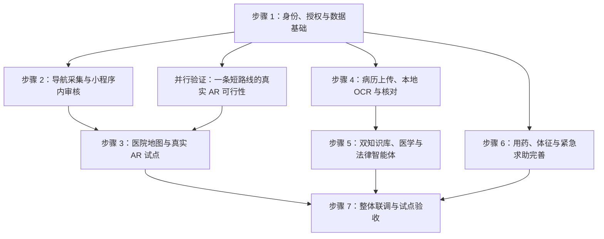

# 医法智联：分步实施路线图

更新：2026-10-17。本文保留实施清单并记录完成范围。M11 本机主流程已交付，详见[M11使用与验收](m11-acceptance.md)；其他模块仍以各步骤状态为准。志愿者、法律志愿者与审核员三种身份的落地计划单列在[身份与后台路线图](roles-roadmap.md)（2026-10-23）。

先看[产品方案](product-plan.md)确定范围，再看[架构方框图](architecture.md)理解依赖；开源候选与限制见[调研记录](research.md)。

## 1. 当前起点

| 已有基础 | 尚不能据此声称的能力 |
| --- | --- |
| 原生小程序健康、导诊、法援、我的及对话页面 | 病历识别、设备监测、真实 AR 已接通 |
| FastAPI、本机 SQLite、固定合成账号、令牌、对象归属与用途授权 | 已完成真实微信身份核验或可保存真实患者资料 |
| 医学/法律分库关键词检索、来源、历史、可替换 Provider；已配置可选 DeepSeek | 已有完整双智能体、向量检索、医学知识图谱或医院 MCP 接入 |
| 长按求助、幂等事件保存、真实标注的本地接收状态 | 已通知医护、已拨通电话、有人接手 |
| M11采集工单、私有照片、独立审核、发布停用、反馈与照片导览 | 已完成真实医院地图生产、AR或现场实走验收 |

现有数据库未加密，固定演示身份不是生产认证；自动化验收使用合成场景。M03产品入口按2026-10-18用户要求改为本人真实检验单上传，身份、存储和部署保护仍需分别完善。开发环境中的本机服务也不等于手机可以直接访问：真机联网与部署需另行配置受控网络及 HTTPS，不能把手机的 `127.0.0.1` 当作电脑。

## 2. 总体顺序

步骤编号是建议组织顺序，不代表所有模块必须串行开发。AR 可行性验证应尽早开展；知识资料整理也可并行，但未经确认的病历不得送入智能体。紧急求助始终独立于模型响应，不等待智能体完成。

模块编号与[产品方案](product-plan.md)保持一致：

| 实施步骤 | 对应模块 | 主要依赖 |
| --- | --- | --- |
| 1 身份、授权与数据基础 | M02 身份授权；所有模块共用的数据基础 | 现有演示基线 |
| 2 导航采集与审核 | M11 志愿者采集、审核与反馈 | 步骤 1 |
| 并行 AR 验证及步骤 3 | M10 地图包与 AR 导航 | 先做少量现场验证，完整试点依赖步骤 2 |
| 4 病历 OCR | M03 病历识别与版本 | 步骤 1 |
| 5 双知识库与双智能体 | M07 知识基础 → M05 医学智能体 / M06 法律智能体；M08 文书草稿 | 步骤 1；个体病历问答另依赖步骤 4 |
| 6 健康与求助闭环 | M04 体征用药、M09 SOS、M08 人工接手 | 步骤 1、明确的真实服务接收方 |
| 7 整体联调 | M01 原生界面与适老化贯穿各步，最终覆盖 M01–M11 | 本次试点范围内模块完成 |

## 3. 每一步具体完成什么

### 步骤 1：身份、授权与数据基础

**范围**：同一个小程序内的普通用户、志愿者、审核人员；角色及医院范围由后端控制。为后续人工接手预留医护/律师的资格、机构和工单归属规则，未完成核验时不开放真实接单。保留患者端，家属经患者同意在同一设备协助，不新增独立家属端。共用账号只能记录账号身份，不能证明实际操作人。

**交付**：身份/角色规则、数据库迁移、私有文件访问控制、用途与接收方授权、撤回及到期校验、审计元数据、备份恢复说明。真实身份与演示身份明确隔离。

**验收**：越权读写被拒绝；撤回后下一次相关访问失败；切换身份后不串草稿和旧响应；重启不丢数据；原有授权和问答测试不回退。真实患者资料接入前补齐加密、真实身份和相应管理条件。

### 步骤 2：导航采集与小程序内审核

**范围**：先一家医院的少量路线。同一小程序增加任务列表、引导采集、提交详情与审核页面，不做 ERP，不另建管理网站。

**交付**：任务领取，分段节点录入，真实图片私有上传，草稿恢复，提交、退回补拍、独立复核，路线版本发布/停用，普通用户问题反馈。发布资料不等于 AR 已经可用。

**验收**：上传失败不显示成功；重试不重复建单；提交后不能偷偷改待审内容；采集者不能审自己的提交；未审核原图不公开；审核和实走结果可追溯；停用后用户不能继续选用该版本。照片仅在本地受控存储，不默认发送外部模型。

### 并行验证：短路线 AR 可行性

**前提**：只能拍摄，不能新增二维码、信标或墙面标识。优先检查现有固定导览图/标牌是否足够独特、稳定，能否登记位置、朝向与尺度。先获得允许采集的范围。

**交付**：一条包含转弯的短路线、一组可用自然参照物、对应楼层路线、目标机型测试记录。分别检查识别地点、解算位置朝向、坐标对齐、跟踪与丢失恢复。

**验收**：使用未参与建图的画面与不同手机验证，不凭采集时的单次成功宣布可用；记录错误地点/楼层、定位耗时、跟踪失败和恢复情况。失去定位就暂停空间箭头。没有合格自然参照物时，重新评估 COLMAP/hloc 视觉定位或缩小覆盖区域，不承诺照片上传后自动实现定位。

### 步骤 3：医院地图与真实 AR 试点

**依赖**：步骤 2 的数据管理链路和短路线可行性验证。

**交付**：医院地图包（楼栋、楼层、节点、可通行边、目的地、参照物、标定及版本），路线规划，原生微信 AR 展示，路线照片与语音提示，失跟后重新定位。换层必须重新确认位置；无障碍路径依赖核验过的通行属性。

**验收**：在现场完成“确定起点—选择目的地—转弯—到达—失跟恢复”；如提供跨层路线，还须验证电梯/楼梯后的楼层确认。没有数据的医院明确显示未开通；不支持 AR 的设备提供明确的普通导览方式，不显示假定位。地图更新须重新验证受影响路段。

**地图有效性**：开始或恢复导航时检查版本、停用状态和有效期；收到停用通知立即停止受影响路段的指引，不能只从列表移除。离线无法保证即时收到停用，必须显示最后核验时间，到期停止路线指引并提示现场确认；缓存和进行中的导航同样受这一规则约束。

### 步骤 4：病历上传、本地 OCR 与核对

**依赖**：步骤 1。先选择一种合成检验单验证，不同时承诺所有手写病历和表格。

**交付**：私有原图、OCR 作业与失败重试、字段及原图定位、待核对/已确认状态、纠错版本、重复上传提示、按就诊事件归档。先用合成报告比较 PaddleOCR 和轻量 RapidOCR；现有后端使用 Python 3.14，OCR 需要在兼容环境的独立进程中验证后确定，不直接假定能装入现有环境。

**验收**：原件不被编辑覆盖；药名、剂量、单位、小数点及模糊项可核对；错误能回查修改记录；只让患者确认并授权选择的资料参与问答。保存资料与发送给外部模型是不同授权操作。

### 步骤 5：双知识库与双智能体

**依赖**：步骤 1；如需病历上下文，还依赖步骤 4。知识整理可提前进行。

**交付**：分别维护医学、法律资料的来源、版本和审核状态；检索、引用、知识图谱证据；医学追问/报告解释流程、法律诉求/材料清单流程；选定资料使用权限；可替换模型与受控工具接口。MCP 按真实需求接入，不把接口协议当作医学能力。

**验收**：双域工具和资料隔离；无依据明确提示；引用能回到原文；每次回答说明使用的材料；紧急情况先显示本地求助提示；无法通过提问绕过授权。测试使用本地 Mock 或受控测试数据，不自动消耗外部模型额度。

**法律特色**：优先完成知情同意材料的大白话解释、患者疑问清单和资料整理；文书先作为可编辑草稿。正式电子签署及医院告知流程另行接入，不能把草稿生成或一次勾选写成有效告知、已签署的事实。

### 步骤 6：健康记录、用药与紧急求助完善

**本轮已交付（2026-10-18）**：M04按无设备条件改为手动健康记录与每日用药管理，包含离散趋势、本人服药记录、复诊待办和手动添加手机日历。详见[M04记录](m04-acceptance.md)。设备监测、院方同步、临床异常告警和微信推送另行接入；本轮未改造紧急求助。

**交付**：用药计划与用户记录分开；体征保留来源、单位、时间和质量；展示历史与数据过期；求助联系人配置、事件状态和重试；患者确认后生成供人工接手的最小摘要。同一小程序提供按角色开放的接单入口，完成待接单、已接单、处理中、结束、失败与取消的工单闭环；接收人身份、资格、机构和可见字段由后端核验，不能只做患者侧按钮。

**验收**：不自行调整医嘱；异常规则经过适用场景审核；数据缺失不能显示正常。长按松手/切后台正确取消；重复重试不重复建事件；本地接收、投递、接收方确认分别显示。未接入渠道时只能显示实际具备的能力，不能假称通知成功。人工接手只能读取患者确认的必要资料；志愿者不因接单获得病历权限，非本人或非所属工单不得读写。

**文书范围**：本轮学生产品目标先包含可编辑草稿、人工审阅意见及工单记录。正式医疗文书的解释、签署、验签和归档属于后续真实接入阶段，待医院流程与签署能力确定再实施；验收清单分别记录，不能用手写签名图片代替已完成可靠签署。

### 步骤 7：整体联调与试点验收

**交付**：端到端测试记录、医院地图包说明、数据处理说明、机型与网络条件清单、错误处置流程、恢复和停用方案。

**验收**：覆盖老人操作、弱网、权限撤回、错误病历、错误地点、模型/OCR超时、相机权限拒绝和服务不可用。现场人员确认试点范围，实测结果决定可开通区域；普通导览与真实 AR、演示服务与真实接入在界面明确区分。

## 4. 后续如何逐步发起工作

每次可直接指定“开始步骤 2：导航采集与小程序内审核”。执行时先核对依赖，再列本次文件、接口和验收范围；完成后更新状态与测试证据，不用口头承诺替代验收。

| 步骤 | 状态 | 完成证据 |
| --- | --- | --- |
| 1 身份、授权与数据基础 | 已完成本轮验收 | 后端 55 项测试通过（含注销后旧令牌 401、切身份数据隔离、跨重开持久化、并发撤回丢弃）；前端 16 项测试通过（含身份存储、版本守卫）；POST /auth/logout 使令牌立即失效；小程序内可切换三个固定演示身份并自动恢复登录态 |
| 2 导航采集与审核 | 主流程已实现，本机自动化验收通过 | 后端78项、M11与身份前端25项通过；原生模板编译通过。页面处理函数接真实HTTP跑通全链路；双角色自审、跨院操作被拒绝。账号选择页已核对模拟器视觉；完整模拟器链路、真机和现场验收待做；修订和回滚需重新独立复核，见[M11记录](m11-acceptance.md) |
| 短路线 AR 验证 | 待现场数据和真机验证 | 待补 |
| 3 真实 AR 试点 | 方案确定，未实施 | 待补 |
| 4 病历 OCR | 本机主流程已实现，自动化验收通过 | 拍照/相册预览、私有原图、独立CPU OCR、原图定位、逐项核对、失败手填/重试、版本归档与更正回查；17项M03后端、8项前端（含真实HTTP+本地OCR）通过。原生编译通过，模拟器视觉/真机验收待做；见[M03记录](m03-acceptance.md) |
| 5 双智能体 | M05医学知识科普、M06法律知识智能体第一版均已闭环；完整多轮工作流、事实梳理和真实人工工具待实施 | SQLite已发布知识源/片段、版本与有效期过滤、聊天引用和知识搜索；可选只读法律MCP；M05识别急症/诊断/用药/报告等类别和主题，急症先劝现场、个人诊断与处方调整拒答，普通问题检索后生成并返回3个追问、3—4个问医生问题；M06识别知情同意/病历/隐私/纠纷/责任/赔偿等类别，高频问题走本地法条指引，责任与赔偿拒答，暴力威胁先报警，返回追问、材料清单、下一步和问医务科/律师清单；历史保存`message_metadata`；知识库13个医学来源/128片段、3个法律来源/20片段；后端全量159项，M05专项12项、M06专项10项通过；见[M05记录](m05-acceptance.md)、[M06记录](m06-acceptance.md)、[M07记录](m07-acceptance.md)。多轮上下文、知识审核后台、向量与图谱待补 |
| 6 健康记录、用药、求助 | M04无设备版已交付，求助沿用现状 | 后端159项通过；前端全量80项/79通过、1跳过（完整权限80通过），健康页16项通过（含真实HTTP）；每日时间改为最多8个滚轮时间点；原生编译通过；设备/医院/后台消息与真机日历待验收，见[M04记录](m04-acceptance.md) |
| 7 联调与试点验收 | 待前述能力就绪 | 待补 |

AR 在本项目属于必须完成的目标，不因分阶段实施而降为可选；它的正式开通取决于现场验证，不取决于演示动画是否完成。
